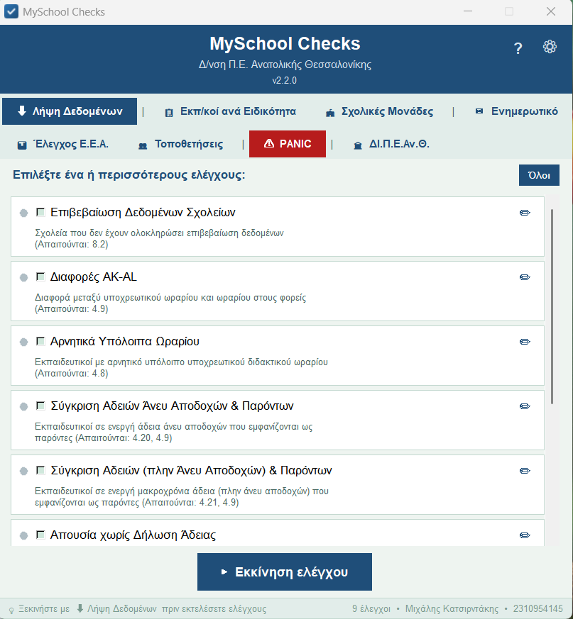

# MySchool Checks

**Αυτοματοποιημένοι έλεγχοι δεδομένων MySchool για Διευθύνσεις Εκπαίδευσης**

Εφαρμογή Windows που συνδέεται στο MySchool, κατεβάζει τα στατιστικά, εντοπίζει λάθη και εκκρεμότητες στα δεδομένα των εκπαιδευτικών και ενημερώνει κάθε σχολείο με email — χωρίς καμία γνώση προγραμματισμού.

## ⬇ Κατέβασμα

👉 **[Τελευταία έκδοση (Releases)](https://github.com/MichalisKat/MySchoolChecks/releases/latest)** — κατεβάστε το `myschool-checks-X.Y.Z-setup.exe` και τον **Οδηγό Χρήστη (PDF)**.

## 🛠 Εγκατάσταση

1. Τρέξτε το `myschool-checks-X.Y.Z-setup.exe`.
   Αν εμφανιστεί προειδοποίηση των Windows (SmartScreen): **Περισσότερες πληροφορίες → Εκτέλεση ούτως ή άλλως**.
2. Επιλέξτε τη **Διεύθυνση Εκπαίδευσης** σας και ολοκληρώστε (Next → Install → Finish).
3. Ανοίξτε το **MySchool Checks** από τη συντόμευση στην επιφάνεια εργασίας.
4. Στις **Ρυθμίσεις (⚙)** συμπληρώστε τα στοιχεία σύνδεσης MySchool και email.

## 🔐 Έγκριση χρήσης (από την έκδοση 4.7.0)

Κάθε υπολογιστής χρειάζεται **έγκριση από τον υπεύθυνο** την πρώτη φορά που ανοίγει μια νέα έκδοση:

1. Εμφανίζεται η οθόνη **«Απαιτείται έγκριση χρήσης»** με τον **κωδικό υπολογιστή**.
2. Το αίτημα στέλνεται **αυτόματα** στον υπεύθυνο.
3. Μόλις εγκριθεί, πατήστε **«Έλεγχος ξανά»** — η εφαρμογή ανοίγει κανονικά.

Η έγκριση ισχύει και χωρίς internet για 30 ημέρες. Σε κάθε νέα έκδοση ζητείται ξανά.

## 🔄 Ενημερώσεις

Η εφαρμογή ελέγχει μόνη της για νέα έκδοση κατά την εκκίνηση και προτείνει την αναβάθμιση.

## ✨ Τι νέο στην 4.7.0

- **Συνολική Αναφορά Σχολείων (Β6)** — μία λήψη, όλοι οι βασικοί έλεγχοι (Α1, Α3, Α5, Α6, Α7, Α9Α, Α9Β), ένα Excel και ένα email για **κάθε** σχολείο, εβδομαδιαία ή έκτακτη, με σήμανση νέων / διορθωμένων εκκρεμοτήτων.
- **⭐ Αστέρια** — τα σχολεία κερδίζουν ένα αστέρι για κάθε έλεγχο χωρίς εκκρεμότητες, με ιστορικό, «τέλειες εβδομάδες» και σερί.
- **Ε5 Λεπτομέρειες ωραρίου** — συγκεντρωτική λίστα αποτυχιών και Excel για επανάληψη μόνο όσων απέτυχαν.
- **Έγκριση χρήσης** ανά υπολογιστή και έκδοση.

## 📖 Τεκμηρίωση

Αναλυτικές οδηγίες για κάθε έλεγχο και εργαλείο στον **Οδηγό Χρήστη (PDF)** που συνοδεύει κάθε έκδοση στα [Releases](https://github.com/MichalisKat/MySchoolChecks/releases/latest).

## ✉ Επικοινωνία

**Μιχάλης Κατσιρντάκης** — Διεύθυνση Π.Ε. Ανατολικής Θεσσαλονίκης
itdipea@sch.gr · 2310 954145

---
Ο πηγαίος κώδικας δεν είναι δημόσιος. Η χρήση επιτρέπεται μόνο σε εγκεκριμένους υπολογιστές Διευθύνσεων Εκπαίδευσης.
